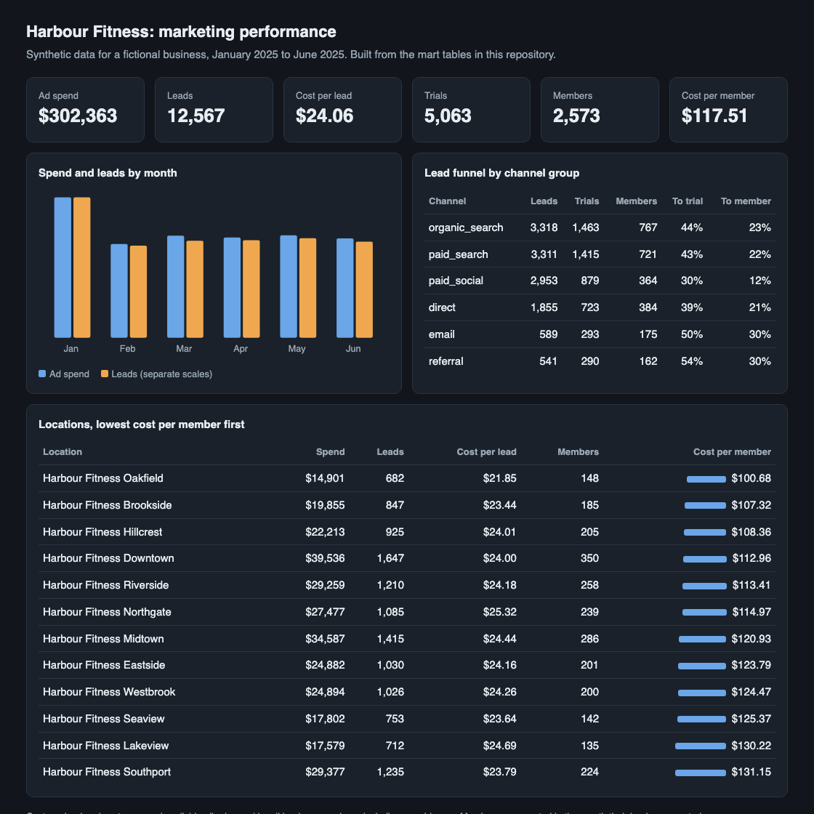
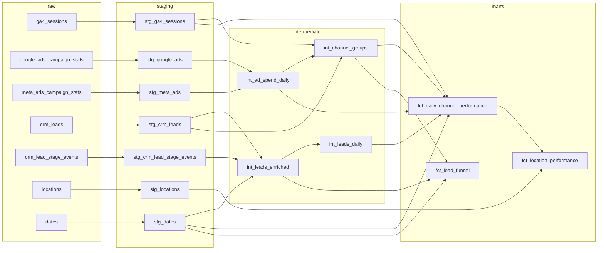

# Marketing warehouse starter

I built this to show how I lay out a small marketing data warehouse: raw ad, web and CRM data in, tested reporting tables out.

Related case study on [mertatalay.com](https://mertatalay.com): [A marketing warehouse that checks itself](https://mertatalay.com/work/marketing-warehouse/).

**The data is synthetic and the business is fictional.** "Harbour Fitness" is a made-up gym chain with 12 locations. A seeded Python script generates every row. This is a starter and a teaching example. It is not a production system, and nothing here comes from a real company.



*The example report, built from the mart tables by `python -m runner.report`. All numbers are synthetic.*

The models are written as a [Dataform](https://cloud.google.com/dataform) project for BigQuery. A small Python runner executes the same `.sqlx` files on DuckDB, so you can build and test everything on a laptop without a cloud account.

## What it models

Harbour Fitness buys ads on Google and Meta. People visit the website and submit a form. That creates a lead in the CRM. Some leads book a trial. Some trials become members. Some leads are lost.

The generator writes seven raw tables:

| Table | Grain |
| --- | --- |
| `ga4_sessions` | day, location, source, medium, campaign (sessions, form submits) |
| `google_ads_campaign_stats` | day, campaign (impressions, clicks, cost in micros) |
| `meta_ads_campaign_stats` | day, campaign (impressions, clicks, spend) |
| `crm_leads` | lead (created date, location, UTM fields) |
| `crm_lead_stage_events` | lead and stage reached (`lead`, `trial`, `member`, `lost`) |
| `locations` | location |
| `dates` | day, with `week_start`, `month_start` and a running day number |

The CRM data is a little messy on purpose. Some `utm_source` values have the wrong case or a trailing space, and direct leads have no UTM values at all. The staging models clean this up.

The models build three reporting tables:

| Mart | Grain | What it answers |
| --- | --- | --- |
| `fct_daily_channel_performance` | day, location, source, medium, campaign | Sessions, clicks, spend and leads side by side |
| `fct_location_performance` | month, location | Spend, leads, cost per lead, trials, members, cost per member |
| `fct_lead_funnel` | lead-created month, location, channel group | Lead to trial to member counts and rates, days to convert |



## Run it

You need [uv](https://docs.astral.sh/uv/) and Python 3.12 or newer.

```sh
uv sync                        # install dependencies
uv run python -m generator     # write synthetic CSV and Parquet files to data/
uv run python -m runner        # load into DuckDB, build the models, run the assertions
```

The runner prints each model with its row count and each assertion with pass or fail. It exits with an error if any assertion fails. The result is a file called `warehouse.duckdb` that you can open with the DuckDB CLI or any DuckDB client:

```sql
SELECT month_start, location_name, spend, leads, cost_per_lead, members, cost_per_member
FROM marts.fct_location_performance
ORDER BY month_start, location_name;
```

To see the result as a page, run `uv run python -m runner.report`. It writes `report.html`, a single self-contained file with no scripts. A copy is in [`docs/example-report.html`](docs/example-report.html).

Run the tests with `uv run pytest`. There is also a Makefile: `make data`, `make build`, `make test`, or `make all`.

The generator takes `--seed`, `--start`, `--end` and `--out`. The same arguments always give the same files. If you change `--end`, also change `freshness_as_of` in `workflow_settings.yaml`, or the freshness assertion will fail.

## How the DuckDB runner relates to Dataform and BigQuery

The repository root is a normal Dataform project: `workflow_settings.yaml` plus `.sqlx` files under `definitions/`. On BigQuery, Dataform compiles those files and runs them.

`runner/` is a stand-in for that step. For each `.sqlx` file it:

1. Removes the `config { }` block and reads the type, schema and name from it.
2. Replaces `${ref("name")}` and `${ref({schema: "...", name: "..."})}` with the local `schema.table` name.
3. Replaces `${dataform.projectConfig.vars.x}` with the value from `workflow_settings.yaml`.
4. Sorts the models by their refs and creates them in DuckDB as views or tables.
5. Runs each assertion query. An assertion passes when it returns no rows.

The model SQL itself is not rewritten. To make that possible I kept it to SQL that both engines accept:

- `x / NULLIF(y, 0)` instead of `SAFE_DIVIDE`.
- Week and month come from the date dimension, not from `DATE_TRUNC`.
- The number of days between two dates is a subtraction of `day_seq` values from the date dimension, not `DATE_DIFF`.
- No backticks and no engine-specific functions in model bodies. A test checks for these.

The runner supports only this plain subset of Dataform. It does not run JavaScript, `js { }` blocks, includes, pre or post operations, or incremental models. If a file uses something it does not understand, it stops with an error.

`make parity` checks the runner against the real compiler. It runs `dataform compile --json` and compares the compiled SQL and dependencies of every model and assertion with what the runner produced. This needs Node and npm access but no cloud credentials.

What this does not prove: that the models run on BigQuery. I have compiled the project with the Dataform CLI. I have not executed it against BigQuery from this repository. See Limits.

## What the assertions check

Each assertion is a `.sqlx` file in `definitions/assertions/`. Each query returns the rows that break a rule, so zero rows means pass. Dataform and the local runner execute the same queries.

| Assertion | Rule |
| --- | --- |
| `assert_unique_keys` | One row per key in each mart, per lead in `int_leads_enriched`, and in both dimensions |
| `assert_non_null_keys` | Key columns in the marts and in `int_leads_enriched` are never null |
| `assert_spend_reconciles` | Monthly ad spend in both marts equals spend in the raw Google Ads and Meta Ads tables, within one cent |
| `assert_lead_counts_reconcile` | Lead totals in all three marts equal the row count of the raw CRM leads table |
| `assert_funnel_is_monotonic` | Members <= trials <= leads in every funnel row, and no lead is a member without a trial |
| `assert_marts_are_fresh` | The newest day in the daily mart is at most `freshness_max_lag_days` behind `freshness_as_of` |

The two reconciliation checks are the ones I care most about. A join that silently drops or duplicates rows is the usual way a marketing report ends up wrong, and comparing mart totals with raw totals catches it.

The freshness check compares against a fixed date in `workflow_settings.yaml`, because the synthetic data ends on a fixed day. With live data you would compare against the current date instead.

The tests also break a built warehouse in six ways and confirm that each assertion fails when it should.

## Tests

`uv run pytest` covers:

- **Generator**: the same seed gives byte-identical CSV files, a different seed does not, and the stage history is ordered.
- **Runner**: config stripping, the three `ref` forms, vars, run order, and loud failure on unsupported syntax.
- **Models on the generated data**: every model builds, every assertion passes, and mart totals match values computed from the raw CSV files in plain Python. This includes cost per lead for one location and month.
- **Models on a hand-written dataset**: six leads and 150.00 of spend, small enough to check on paper. The expected mart rows are written out as literals in `tests/test_hand_computed.py`.

## Layout

```
generator/             synthetic data generator
definitions/
  sources/             declarations of the seven raw tables
  staging/             one cleaning view per raw table
  intermediate/        stacked ad spend, one row per lead, channel groups
  marts/               the three reporting tables
  assertions/          data tests
runner/                runs the .sqlx files on DuckDB
tests/                 pytest suite
workflow_settings.yaml Dataform project settings
```

## Limits

- **Not run on BigQuery.** The project compiles with the Dataform CLI, and the CI workflow includes that compile step. Nothing in this repository deploys to or queries BigQuery. I avoided syntax I know to be engine-specific, but until the models run there, BigQuery compatibility is a design goal and not a tested fact.
- **No loader for BigQuery.** To try it there you would load the generated files into a `raw` dataset yourself and set `defaultProject` in `workflow_settings.yaml`.
- **No real connectors.** There is no GA4 export, Google Ads transfer, Meta API or CRM sync. The raw tables are simplified versions of what those sources provide. Real exports have more columns, late-arriving data and schema changes.
- **No incremental models.** Every model is a full rebuild. That is fine at this size and wrong for large event tables.
- **Attribution is last touch by UTM only.** A lead is credited to the source, medium and campaign stored on its CRM record. There is no multi-touch model, no click IDs, no view-through and no offline matching.
- **Spend is tied to a location by the campaign.** Each campaign belongs to one location. Shared or brand-wide campaigns would need an allocation rule that is not here.
- **Cost per lead is blended.** `cost_per_lead` and `cost_per_member` divide all ad spend by all leads or members, including unpaid ones. `cost_per_paid_lead` is there as the stricter number.
- **Cohorts are by lead-created date.** Trials and members are counted in the month the lead was created. Recent months look worse because their leads have had less time to convert.
- **The runner is a subset of Dataform.** No JavaScript, no includes, no built-in `assertions:` config, no incremental logic. It is a test harness for plain SQL models.
- **The synthetic data is simple.** One currency, no refunds or cancellations, no duplicate leads, no tracking gaps, no seasonality beyond a weekday pattern and a January bump. Do not read the numbers as benchmarks.
- **No orchestration, access control, cost monitoring or documentation site.**

## License

MIT. See [LICENSE](LICENSE).
